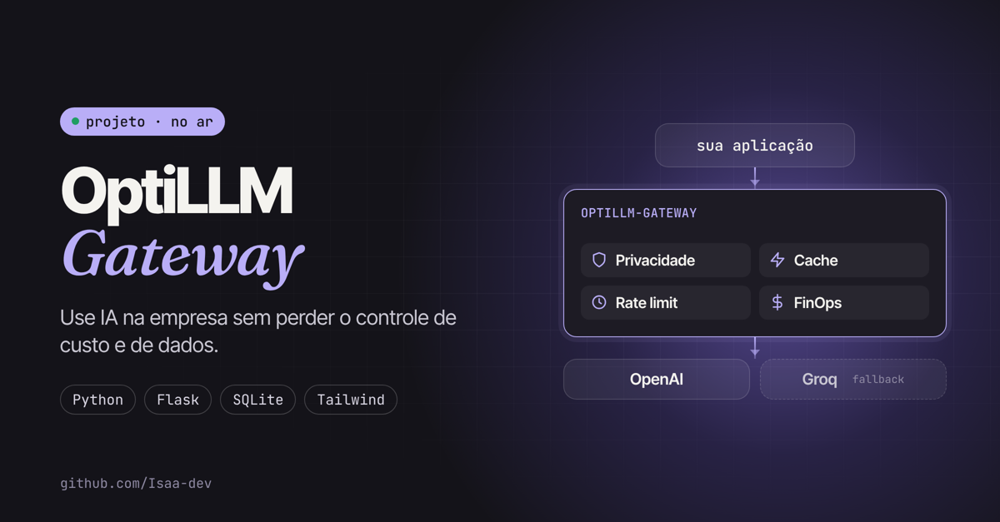

  
  
  

## 👋 Oi, eu sou a Isabella

Comecei no atendimento, resolvendo o problema de quem estava do outro lado da tela. Hoje escrevo o código que evita que ele aconteça.

- 🔭 **Agora:** Analista de TI Jr. na **Seta Tech**, entre infraestrutura e desenvolvimento
- 🌱 **Estudando:** Análise e Desenvolvimento de Sistemas na FAM
- 🧭 **Antes da TI:** atendimento e dados no will bank, onde aprendi a ver o produto pelos olhos de quem usa
- ⚡ **Meu jeito:** gosto de entender *por que* quebrou antes de consertar

## 🐞 Como eu trabalho

## 🚀 Projeto em destaque

**[OptiLLM-Gateway](https://github.com/Isaa-dev/optillm-gateway)** · [ver demo ao vivo ↗](https://optillm-gateway-zl5n.onrender.com)

Gateway entre aplicações e APIs de IA: calcula o custo de cada requisição, mascara dados pessoais antes de chegarem ao modelo, usa cache para evitar chamadas repetidas e troca de provedor automaticamente quando um falha.

### Outros projetos

| | Projeto | Stack |
|---|---|---|
| 📅 | **Escalify** — SaaS de escalonamento de equipes, com painel admin e confirmações em tempo real | React · TypeScript · Firestore |
| 🎁 | **[Manifestando Bondade](https://github.com/Isaa-dev/projeto-manifestando-bondade)** — inscrições para um Natal Solidário, com formulário em etapas e painel privado da equipe | JavaScript · Apps Script · Sheets |
| 🧾 | **[Declarô](https://github.com/Isaa-dev/Saas-Declar-)** — assistente de Imposto de Renda com IA *(em desenvolvimento)* | React · TypeScript · Gemini |
| 🌐 | **[Portfólio](https://github.com/Isaa-dev/Portfolio)** — site bilíngue com animações, sem framework | HTML · CSS · JavaScript |

## 🛠️ Stack

  
  
  
  
  
  
  
  
  

---

  <em>"Um sistema bem feito é invisível para o usuário, mas inestimável para o negócio."</em>

